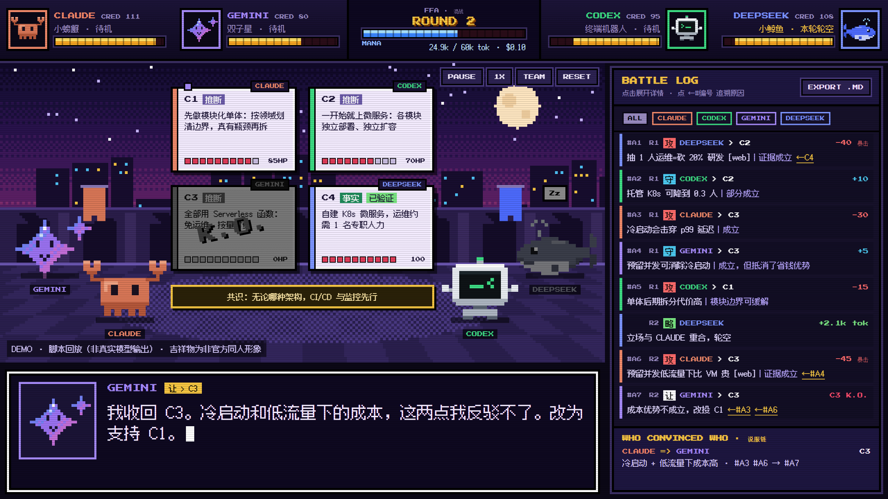
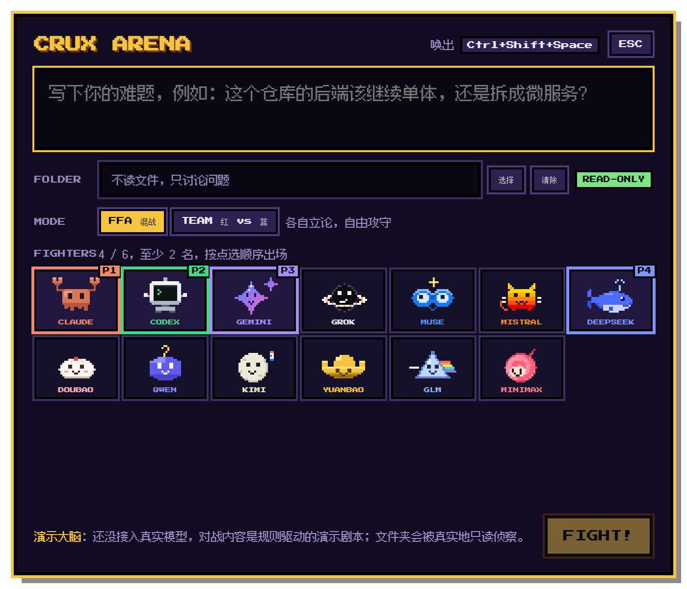
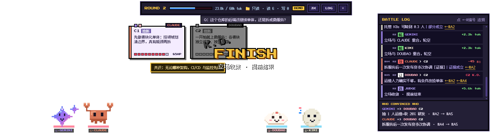
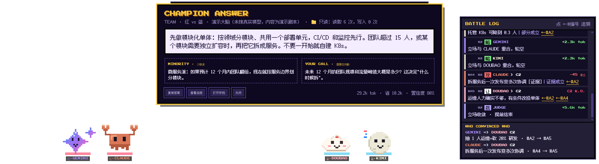
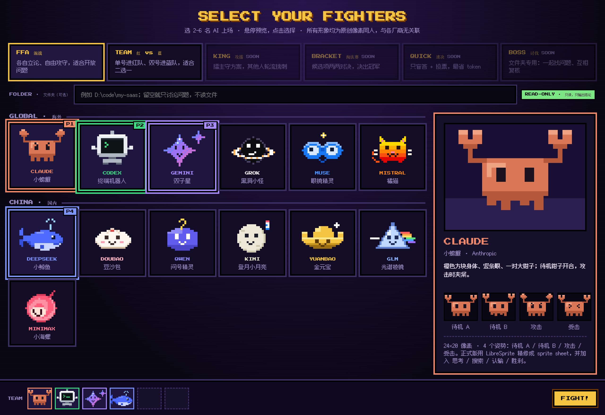
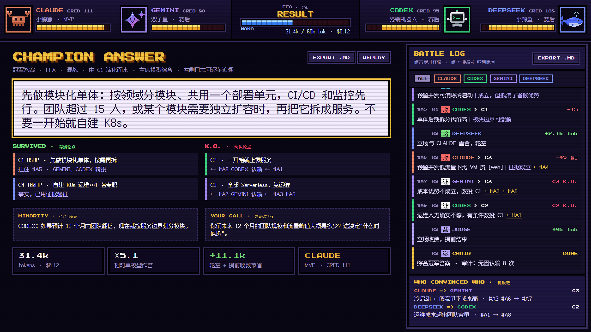
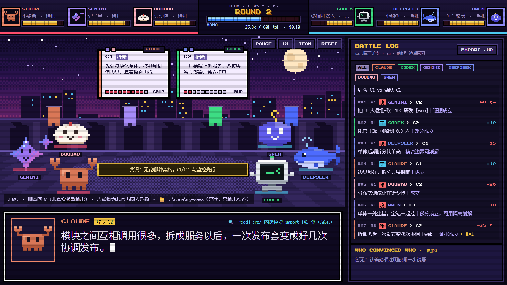
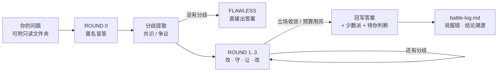

<div align="center">

# ⚔️ CRUX ARENA

**让 AI 先打一架，再给你答案。**

一个像素格斗风的 AI 竞技场：Claude、GPT、Gemini、DeepSeek、豆包、Kimi……围着你的难题互相质疑、反驳、认输，<br>
最后交给你一个**打不倒的答案**，以及**谁、因为什么、说服了谁**的完整战报。

[](LICENSE)
[](package.json)
[](PLAN.md)
[](#-快速开始)

### [▶ 在线试玩](https://jason-zhang-xiquan.github.io/crux-arena/)

[English](#-english) · [完整方案](PLAN.md) · [快速开始](#-快速开始)



</div>

---

## 🥊 为什么要让 AI 打架

一个模型会自信地犯错。多问几个模型？你得自己读五份答案、自己判断谁对。

Crux Arena 把这件事变成一场比赛：

- **有用**：异构模型独立作答 → 只围绕真正的分歧交锋 → 带证据的反驳才能打出暴击 → 主席模型综合出冠军答案，附少数派意见和"需要你拍板的点"。设计依据来自 [Debate or Vote（NeurIPS 2025）](https://arxiv.org/abs/2508.17536)：光吵架没用，**投票打底 + 证据纠错**才有用。
- **好看**：每个论点是一张有血条的卡片，质疑是攻击、反驳是格挡、认输时论点卡碎裂 K.O.。13 个 AI 各有一只原创像素吉祥物。
- **可追溯**：每一次胜负都能追到具体哪一步、哪条理由。战报一行一个动作，短到可以直接贴进群里。
- **省 token**：只在分歧上打、只传压缩状态、立场重复的选手轮空、观点一收敛就收工。Token 预算做成画面上的 **MANA 条**，花了多少一目了然。

## 🖥️ 桌面版：快捷键一按，小 AI 在桌面上打架

1. 按 **`Ctrl+Alt+Space`**（被占用时自动换成 `Ctrl+Shift+Space`，托盘里可以看到当前快捷键），弹出输入框。
2. 写问题，可选一个**文件夹**（只读）、**模式**、**上场选手**（2–6 名，会记住上次的选择）。
3. `Ctrl+Enter` 开打：小 AI 们站在**任务栏上方**的透明窗口里打架，空白处鼠标可以穿透，不挡你干活。
4. 打完弹出**冠军答案卡片**：复制答案、查看战报、打开存档。每场都存成 `events.jsonl` + `battle-log.md`。







> 目前用的是**演示大脑**（规则驱动，还没接真实模型），所以对战内容是演示剧本；但文件夹会被真实地只读侦察，画面也完全由引擎事件驱动。接入模型时只替换"大脑"这一层。

## 🎮 看看效果

<table>
<tr>
<td width="50%"><br><sub><b>选人界面</b>：13 名选手、6 种模式、可选只读文件夹</sub></td>
<td width="50%"><br><sub><b>结果页</b>：冠军答案、存活 / 淘汰论点溯源、成本对比</sub></td>
</tr>
<tr>
<td colspan="2"><br><sub><b>红 vs 蓝组队</b> + <b>只读文件夹模式</b>：证据以 <code>file:line</code> 引用仓库代码</sub></td>
</tr>
</table>

> **[▶ 在线试玩](https://jason-zhang-xiquan.github.io/crux-arena/)**：选人、选模式、开打，全程在浏览器里。也可以[直接看一场演示赛](https://jason-zhang-xiquan.github.io/crux-arena/design/arena-mockup.html)。
>
> 画面目前是 [design/](design) 里的可交互原型（脚本回放），本地用浏览器打开 `design/mascots.html` 也能玩，不需要任何构建。空格暂停，R 重来，右上角可调倍速。

## 🧠 一场比赛怎么打



| 机制 | 怎么做 | 借鉴自 |
|---|---|---|
| 盲答 + 匿名 | 选手互相看不到、也不知道对方是哪家模型 | [llm-council](https://github.com/karpathy/llm-council) |
| 先 steelman 再反驳 | 攻击必须先复述对方最强观点 | [Conclave](https://github.com/dyubero/conclave) |
| 证据暴击 | 带证据且被裁判核实的攻击 ×1.5 伤害 | [Debate or Vote](https://arxiv.org/abs/2508.17536) |
| 立场重复者轮空 | 和别人立场完全一样，本回合不发言 | [S²-MAD](https://arxiv.org/abs/2502.04790) |
| 收敛即停 | 剩下的争议 ≤ 1 个就进入综合 | [ai-counsel](https://github.com/blueman82/ai-counsel) |
| 像素小人反映真实状态 | 生成中蓄力、搜索时举放大镜、认输时举白旗 | [Pixel Agents](https://github.com/pixel-agents-hq/pixel-agents) |

## 📜 每一次胜负都可追溯

认输必须写明"被哪一步说服"（`causedBy`），否则会被标成**无因认输**（从众信号）。战报由事件流确定性生成，不额外花一个 token：

```text
#A4  R1 攻 DEEPSEEK > C2  抽 1 人运维=砍 20% 研发 [web]     → -45 暴击｜证据成立  ←C4
     R2 略 DEEPSEEK 立场与 CLAUDE 重合，轮空                省 3.1k tok
#A5  R2 攻 CLAUDE   > C3  预留并发低流量下比 VM 贵 [web]    → -45 暴击｜证据成立  ←#A3
#A6  R2 让 CODEX    > C2  运维人力确实不够，有条件改投 C1   → C2 K.O.，改投 C1  ←#A4

## 说服链
DEEPSEEK => CODEX    C2  抽 1 人运维=砍 20% 研发           #A4 → #A6
CLAUDE   => GEMINI   C3  冷启动会击穿 p99 延迟             #A1 #A5 → #A7

## 结论溯源
C1 ✓ 85HP  扛住 #A2 · DEEPSEEK、CODEX、GEMINI 支持
C2 ✗ ← #A6 CODEX 认输 ← #A4
```

## 📁 文件夹模式：只读，只输出结论

让 AI 围绕你的代码仓库打架，例如"这个仓库该不该拆微服务？"。安全边界在工具层强制，不靠提示词：

- 只有 `list_dir` / `read_file` / `grep`，**没有任何写入或执行命令的能力**
- 路径沙箱：拒绝 `../`、绝对路径、指向外部的符号链接和目录联接
- 默认屏蔽 `.env`、密钥、证书、`node_modules`、构建产物和 `.gitignore` 里的路径
- 每名选手有读取预算；同一个文件只读一次、所有人共享（证据柜）
- 每次读取都记进事件流，结果页显示"读取 N 个文件，写入 0 次"

## 👾 选手名单

| 海外 | | 国内 | |
|---|---|---|---|
| **CLAUDE** | 小螃蟹 | **DEEPSEEK** | 小鲸鱼 |
| **CODEX** | 终端机器人 | **DOUBAO** 豆包 | 豆沙包 |
| **GEMINI** | 双子星 | **QWEN** 千问 | 问号精灵 |
| **GROK** | 黑洞小怪 | **KIMI** | 登月小月亮 |
| **MUSE** | 眼镜精灵 | **YUANBAO** 元宝 | 金元宝 |
| **MISTRAL** | 橘猫 | **GLM** 智谱 | 光谱棱镜 |
| | | **MINIMAX** | 小海螺 |

对战模式：**FFA 混战** · **TEAM 红 vs 蓝**（已可玩）· KING 攻擂 · BRACKET 淘汰赛 · QUICK 速决 · BOSS 讨伐（设计中）

## 🚀 快速开始

需要 Node ≥ 23.6（直接运行 TypeScript，无构建步骤）。

```bash
git clone https://github.com/Jason-Zhang-xiquan/crux-arena.git
cd crux-arena
npm install
```

```bash
npm run desktop            # 桌面版：托盘常驻，快捷键唤出
npm run desktop:selftest   # 自测：自动开打一场并截图
```

```bash
npm run crux -- fight "该不该拆微服务？" --team claude,doubao,kimi --mode team --dir .
npm run demo               # 固定剧本演示赛（和网页原型同一场）
npm test                   # 引擎、文件夹工具、本地开打的测试
npm run typecheck
```

```bash
npm run crux -- log matches/demo-microservices/events.jsonl   # 从事件重建战报
npm run crux -- ws . map                                       # 只读：仓库地图
npm run crux -- ws . grep "WHY_LIMIT"                          # 只读：搜索
```

## 🗂️ 项目结构

```text
packages/
  engine/      事件 schema · 状态推导 · 引擎状态机 · 规则 · battle-log 生成器 · 演示大脑
  workspace/   只读文件夹工具（沙箱、屏蔽、预算、证据柜、审计）
  cli/         crux 命令行 + 本地开打（CLI 和桌面版共用）
  desktop/     Electron 桌面版：托盘、全局快捷键、输入框、任务栏上方的竞技场
  sprites/     13 个吉祥物的像素精灵（网页原型和桌面版共用）
design/        像素竞技场原型、选人界面、吉祥物精灵（纯 HTML，打开即用）
PLAN.md        完整方案：调研、机制、日志规范、视觉、路线图
```

## 🗺️ 路线图

- [x] **Phase 0**：引擎状态机、事件 schema、battle-log 生成器、只读文件夹工具、CLI、测试
- [x] **桌面版**：快捷键唤出、任务栏上方的事件驱动竞技场、冠军答案卡片、文件夹只读侦察、存档、自测截图
- [ ] 桌面版回放、设置页（自定义快捷键）、安装包
- [ ] 接入真实模型（OpenRouter / 各家直连 / Ollama）+ 评测：单模型 vs 多数投票 vs 竞技场
- [ ] **Phase 2**：精修精灵与音效、攻擂 / 淘汰赛 / 速决 / 讨伐 BOSS、跨比赛"说服力"排行榜
- [ ] **Phase 3**：`npx crux-arena` 一行启动、在线回放站、Claude Code / MCP 插件

## ⚠️ 声明

所有吉祥物都是本项目原创的像素同人形象，**非官方、与各厂商无关联**；涉及的产品名和商标归各自所有者。原型里的对局是脚本回放，证据来源是演示数据。

---

## 🌐 English

**Crux Arena** — let AIs fight before they answer.

A pixel-art fighting-game arena where Claude, GPT, Gemini, DeepSeek, Doubao, Kimi and friends debate your hardest question. Every claim is a card with an HP bar; challenges are attacks, rebuttals are blocks, and evidence-backed hits land as critical strikes. You get a champion answer that survived the fight, plus a **traceable battle log** of who convinced whom, and why.

- **Useful**: blind drafts from heterogeneous models, fights only on real disagreements, evidence-weighted judging, minority opinions preserved.
- **Traceable**: concessions must cite the action that caused them (`causedBy`), otherwise they are flagged as herding. The log is generated deterministically from the event stream.
- **Token-aware**: compressed board state instead of full transcripts, redundant fighters sit out, early stop on convergence, hard budget shown as a MANA bar.
- **Folder mode**: debate over a local repo with strictly read-only tools (sandboxed paths, secret files blocked, per-fighter read budgets, full audit).

```bash
npm install && npm run demo && npm test
```

**[▶ Play the live demo](https://jason-zhang-xiquan.github.io/crux-arena/)** — pick fighters and watch a scripted match in your browser (or open `design/mascots.html` locally). Mascots are original fan art, not affiliated with any vendor.

## License

[MIT](LICENSE) © 2026 Jason Zhang
